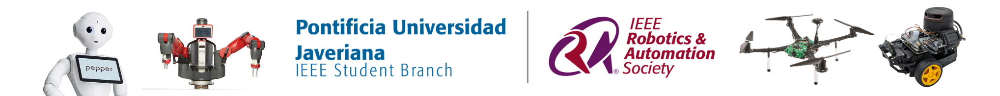

# PROJECT SALLY

SALLY is an educational mobile robotics project developed using **ROS 2**. The project integrates motor control, servo-based steering, a two-degree-of-freedom neck mechanism, and ultrasonic sensing ( needs to be completed and detailed by the Sally's developer team ).

## Technologies

- ROS 2 Jazzy
- Ubuntu 24.04 LTS
- Python 3
- Raspberry Pi
- PCA9685 PWM Driver

## Project Structure

To be completed by the development Sally's developer team

## Installation and Dependencies

To be completed by the development Sally's developer team

## Usage

To be completed by the development Sally's developer team

## Contributors

To be completed by the development Sally's developer team

---

