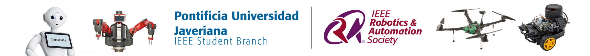

# Changelog

All notable changes to **PROJECT SALLY** will be documented in this file.

## Purpose

This changelog aims to maintain a clear and organized record of the project's development, including new features, improvements, bug fixes, and architectural modifications.

Each contributor is responsible for documenting relevant changes to ensure traceability and facilitate collaboration throughout the project.

## [Unreleased]

_Template for future contributions._

### Added

- [Describe new features, packages, or functionalities.]

### Changed

- [Describe improvements or modifications to existing components.]

### Fixed

- [Describe bugs, errors, or compatibility issues resolved.]

### Removed

- [Describe deprecated or removed functionalities.]

---

## [2026-11-13] — Initial Repository Improvements

**Contributor:** [Nidhood](https://github.com/Nidhood)

### Added

- Initial `README.md` with project overview, technologies, and documentation sections for future development.
- IEEE RAS Javeriana footer image.
- `sally_bring_up` package with initial launch and configuration files.
- Initial package structure and configuration files for hardware interfaces, sensors, and control.
- `requirements-hardware.txt` to centralize Python hardware dependencies.
- `install_python_dependencies.sh` script for workspace dependency installation.

### Changed

- Reorganized the repository into modular ROS 2 packages to improve maintainability and separation of responsibilities.
- Updated Python dependency declarations for Adafruit Blinka, PCA9685, and Motor libraries.
- Updated package metadata and dependency configuration.

### Fixed

- Replaced the hardcoded Python virtual environment path with a portable Python interpreter declaration in the PCA9685 node.

---

## Contribution Guidelines

When making changes, contributors should:

1. Document relevant modifications under **Unreleased**.
2. Classify changes as Added, Changed, Fixed, or Removed.
3. Keep descriptions brief, technical, and clear.
4. Move completed changes into a dated section when preparing a new project update.

---

